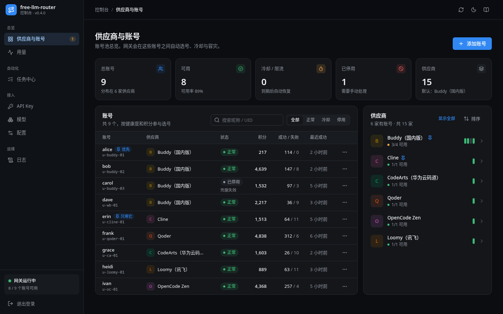

<div align="center">

# free-llm-router

**把多家大模型供应商的账号池，汇成统一的 OpenAI + Anthropic 兼容 API。**

自动选号 · 冷却与容灾 · 签到与每日任务自动跑 · 生图 / 视频 / 混元 3D / 语音 TTS·ASR / 联网检索 · 自带管理面板


</div>

> [!WARNING]
> **仅限本人授权的账号自用。** 不支持、也不鼓励批量注册、账号出租或转售 API，详见 [使用边界](#使用边界)。



## 目录

- [特性](#特性)
- [两种部署形态](#两种部署形态)
- [快速开始](#快速开始)
  - [方式 A：本地版（不用服务器）](#方式-a本地版不用服务器)
  - [方式 B：VPS / NAS / Docker](#方式-bvps--nas--docker)
  - [方式 C：直接跑 Node](#方式-c直接跑-node)
- [接入客户端](#接入客户端)
- [媒体能力](#媒体能力)
- [支持的供应商](#支持的供应商)
- [管理面板](#管理面板)
- [API 一览](#api-一览)
- [更新与升级](#更新与升级)
- [已知限制](#已知限制)
- [使用边界](#使用边界)

## 特性

### 网关

- **双协议原生入口**：`/v1/models`、`/v1/chat/completions`、`/v1/responses`、`/v1/messages`（含 `/v1/messages/count_tokens`），支持流式、非流式、思考链和工具调用。数据面同时支持 `Authorization: Bearer <key>` 与 `x-api-key: <key>` 鉴权，并支持通过 `CORS_ORIGINS`（或面板配置页）控制跨域白名单。
- **出站自动修正与续写救援**：工具调用配对断裂与跨轮重排、工具参数 Schema 归一化、Responses 结构化输出与 `reasoning.encrypted_content` 签名回传、Anthropic 工具内嵌图片与 `cache_read_input_tokens` 精确扣除均在网关内完成；支持可选开启流式截断自动续写与 Agent 预告句悬停救援（`AUTO_CONTINUATION=true`）。
- **16 家供应商**：Buddy、WorkBuddy、Cline、MiniMax、CodeArts、LobsterAI、TRAE、Qoder（国内 / 国际）、OpenCode、Raccoon、ZCode、Loomy、Gemini（OAuth + API Key）、Meoo、ModelScope（魔搭社区）。

### 账号池

- **自动调度与 Pro 专属模型分层**：默认先用积分最早到期的账号；针对 Pro 付费专属模型优先挑选付费档账号（无付费号时自动兜底）；按调用方作用域（`user` / `metadata.user_id` / 子密钥 ID）隔离会话粘性槽位。
- **冷却与熔断**：账号级 / 模型级分开；`11140` 区域波次闸门按号池规模动态缩放阈值并支持指数退避与平静期清零；国内版全部不可用时自动切国际版。
- **聚合模型**：`aggregate/<模型名>` 把多家的同一个模型归到一起，优先走积分最快作废的渠道，失败自动换下一家。
- **多账号登录**：面板里设备码、扫码、短信登录，或粘贴凭据 / API Key 导入（自动识别是哪一家）。

### 自动化

- **每日签到**、**成长任务**（覆盖 `skill_share`、`Sequential_Tasks_1` / `Sequential_Tasks_2`、专家体验、模板、画布、连登兑换、抽奖、猫猫旅行等全套任务）。
- **运营活动查询与领奖**：内置 `/admin/campaign` 与 `/admin/campaign/claim`（默认 `dryRun: true` 安全预演，确认后一键领取星巴克等运营活动奖励）。
- **国际版每日活跃**：自动跑完网页端 agent 会话（这是国际版拿积分的唯一方式）。
- **后台维护**：每小时续期凭据、刷新余额、清理会话；到期时间未知的凭据也会保活。

### 媒体能力与混元 3D

- **生图** `/v1/images/generations`、**改图** `/v1/images/edits`（国际版账号，支持传入本地图片 data URL）
- **视频** `/v1/videos/generations`、`/v1/videos/tasks`（国际版账号，异步提交 + 归属账号轮询，支持首尾帧图生视频与 `reference_images` / `reference_videos` / `reference_audios` 参考素材）
- **混元 3D** `/v1/3d/generations`、`/v1/3d/tasks`、`GET /v1/3d/:jobId`（国际版与国内版 OAuth 账号均支持，自动签发临时云凭证 + TC3 签名，输出 `GLB` / `OBJ` / `FBX` / `STL` / `USDZ`）
- **联网检索** `/v1/search`、**网页抓取** `/v1/fetch`（双分片智能选号、边缘错误止损与直连回退）；同时提供 `/v1/tools/search|fetch|search_fetch` 与伪模型 `wb-search` / `wb-fetch` / `wb-search-fetch`（直接经 Chat 协议返回结果，不消耗模型额度）
- **网页工具注入**：Anthropic `web_search_*` / `web_fetch_*` 与 Responses 托管 `web_search` 由网关真实执行预检索并注入上下文，不再静默丢弃
- **语音** `/v1/audio/speech`（TTS，WAV / PCM，带流完整性校验与自动换号重试）与 `/v1/audio/transcriptions`（ASR，multipart，`json` / `text` 输出，3 MiB 上限）
- **MCP** `/mcp` —— OpenCode / Claude Code / Cursor / Cline 自动发现 7 项工具（检索、抓取、生图、视频提交/查询、3D 提交/查询）

### 管理与安全

- **子密钥**：给不同工具各发一把 Key（兼容 Bearer 与 `x-api-key`），可限制请求数、token 数、可用模型（含 `/v1/messages` 与媒体/3D 路由）、来源 IP（CIDR）、过期时间。
- **管理面板**：8 个视图（含 3D 生成工作台与数据面 CORS 配置），深浅主题，手机可用；默认注入 `X-Robots-Tag: noindex, nofollow` 防搜索引擎收录，严格 CSP。
- **凭据加密**：AES-GCM 落盘，密钥不进数据库（除非你选择自动生成）。

## 两种部署形态

| | 本地版 | VPS / 服务器 |
|---|---|---|
| 适合谁 | 自己电脑上用，不想折腾服务器 | 要常驻、要给别人用、要 7×24 跑任务 |
| 怎么装 | 下载压缩包，双击启动 | Docker 或裸 Node + systemd |
| 数据在哪 | 程序同目录 `data/router.db` | 你指定的路径 |
| 开机自启 | ❌ 手动启动 | ✅ systemd / Docker restart 策略 |
| 依赖 | 只要 Node.js 22+ | 只要 Node.js 22+ / Docker |

> 两者是**同一份代码**，只是启动方式不同。数据格式完全一致，可以互相搬。

## 快速开始

### 方式 A：本地版（不用服务器）

**1. 装 Node.js 22+**

| 平台 | 做法 |
|---|---|
| Windows | 去 [nodejs.org/zh-cn](https://nodejs.org/zh-cn) 下载 **LTS** 的 `.msi`，安装时**勾选 Add to PATH**，装完重启电脑 |
| macOS | `brew install node`，或从 nodejs.org 下 `.pkg` |
| Linux | `nvm install 22` 或发行版官方源 |

验证：终端里执行 `node -v`，看到 `v22.x.x` 或更高即可。

**2. 下载并启动**

```bash
# 从 Releases 下载 free-llm-router-local-vX.Y.Z.zip 并解压
cd free-llm-router-local

# Windows：双击 start-windows.bat
# macOS / Linux：
chmod +x start-mac-linux.sh && ./start-mac-linux.sh
```

启动后会自动打开浏览器，屏幕上同时打印**面板地址**与**登录口令**。

```
  ==========================================
    free-llm-router  -  本地版
  ==========================================

  面板地址   http://127.0.0.1:11451/panel/
  登录口令   sk-xxxxxxxxxxxxxxxxxxxxxxxx
  数据目录   /你的路径/data
```

> ⚠️ 那个终端窗口不能关，关掉服务就停了。

**3. 添加账号**

打开面板 → 「供应商与账号」→ 选供应商 → 设备码 / 扫码 / 粘贴凭据。

### 方式 B：VPS / NAS / Docker

```bash
git clone https://github.com/NandaNg314/free-llm-router.git && cd free-llm-router
npm install
npm run build:web && npm run build:node      # 产出 dist/server.mjs（已含面板）

echo "API_KEY=$(openssl rand -hex 24)" > .env
echo "CREDENTIAL_KEY=$(openssl rand -base64 32)" >> .env
cat .env                                      # 记下 API_KEY，登录面板用

mkdir -p data && sudo chown -R 1000:1000 data # 容器内以 uid 1000 运行
docker compose up -d
```

访问 `http://服务器IP:11451/panel/`。

> ⚠️ **务必配置 `CREDENTIAL_KEY` 并备份**：它加密账号凭据。丢了它，所有账号解不开，只能重新登录。
> 不配的话服务会自动在数据库里生成一个 —— 那样一旦 `data/` 丢失同样无法恢复。

**公网部署建议**：用 Caddy / Nginx 反代并只监听 `127.0.0.1`，不要直接暴露端口。

### 方式 C：直接跑 Node

```bash
node --env-file=.env dist/server.mjs
```

需要 Node.js ≥ 22.13（用到内置 `node:sqlite`，零原生依赖、无需编译）。

## 接入客户端

| 客户端 | 配置 |
|---|---|
| **OpenAI SDK / 任何兼容客户端** | Base URL `http://127.0.0.1:11451/v1`，API Key 填子密钥 |
| **Cherry Studio / ChatBox / Open WebUI / LobeChat** | 同上；生图也走这一套（`/v1/images/generations`） |
| **Claude Code / Anthropic SDK** | `ANTHROPIC_BASE_URL=http://127.0.0.1:11451`、`ANTHROPIC_API_KEY=<主密钥或子密钥>`（原生支持 `/v1/messages`、`/v1/messages/count_tokens` 与 `x-api-key` 头） |
| **Codex / DSH** | Base URL + `/v1/responses` |
| **OpenCode / Cursor / Cline** | MCP：`/mcp`（见下） |

### MCP 接入

```bash
opencode mcp add my-router --global \
  --url http://127.0.0.1:11451/mcp \
  --header 'Authorization=Bearer 你的API_KEY'
```

接入后 AI 会自动发现 7 个工具：`web_search` / `web_fetch` / `generate_image` / `generate_video` / `get_video_task` / `generate_3d` / `get_3d_task`。

## 媒体能力

生图与视频需要 **WorkBuddy 国际版账号**；混元 3D 生成、联网检索与抓网页支持国际版与国内版 OAuth 账号自动选号与容灾。

### 生图

```bash
curl -X POST http://127.0.0.1:11451/v1/images/generations \
  -H "Authorization: Bearer $KEY" -H 'Content-Type: application/json' \
  -d '{"prompt":"一只橘猫坐在窗台上，水彩风格","size":"1024x1024"}'
```

模型是 `hy-image-3.5`，实测约 **10–15 秒**、**0.03 积分/张**。

### 改图（可传本地图片）

`image` 字段接受**公网 URL** 或 **`data:image/...;base64,...`**。面板里选图会自动转成 data URL。

```bash
curl -X POST http://127.0.0.1:11451/v1/images/edits \
  -H "Authorization: Bearer $KEY" -H 'Content-Type: application/json' \
  -d '{"prompt":"把背景换成星空","image":"data:image/png;base64,..."}'
```

> 本网关**不下载、不转存**图片 —— 上游要能直接取到它。

### 视频（异步）

```bash
# 1. 提交（图生视频就加 "image": "data:image/...")
curl -X POST http://127.0.0.1:11451/v1/videos/generations \
  -H "Authorization: Bearer $KEY" -H 'Content-Type: application/json' \
  -d '{"prompt":"一只小猫在草地上奔跑，镜头跟随","seconds":4}'
# → {"id":"1372715883-WandVideo-…","status":"queued"}

# 2. 查询（⚠️ 是 POST，不是 GET）
curl -X POST http://127.0.0.1:11451/v1/videos/tasks \
  -H "Authorization: Bearer $KEY" -H 'Content-Type: application/json' \
  -d '{"task_id":"1372715883-WandVideo-…"}'
```

模型 `kling-video-v3`，实测 **约 73 秒**、**约 29 积分**/4 秒片；同时支持传入 `reference_images` / `reference_videos` / `reference_audios`（字符串 URL 数组或对象数组均可，网关自动归一化为上游格式）。

> ⚠️ **不要用涉政、真实领导人、敏感事件等题材** —— 上游风控会直接拒绝，
> 返回 `failed` 与原因（`Failure to pass the risk control system`）。
> 这类失败**不扣积分**（上游失败任务不回 `usage`，实测确认）。

### 混元 3D 生成（异步）

```bash
# 1. 提交文生 3D 或图生 3D（支持 GLB / OBJ / FBX / STL / USDZ）
curl -X POST http://127.0.0.1:11451/v1/3d/generations \
  -H "Authorization: Bearer $KEY" -H 'Content-Type: application/json' \
  -d '{"prompt":"一把蒸汽朋克单手剑，精细PBR材质","model":"3.1","result_format":"GLB","enable_pbr":true}'
# → {"id":"job_...","job_id":"job_...","object":"3d.task","status":"RUN"}

# 2. 按原提交账号轮询任务状态（POST /v1/3d/tasks 或 GET /v1/3d/:job_id）
curl -X POST http://127.0.0.1:11451/v1/3d/tasks \
  -H "Authorization: Bearer $KEY" -H 'Content-Type: application/json' \
  -d '{"job_id":"job_..."}'
```

### 语音合成与语音识别（TTS / ASR）

```bash
# 1. 文字转语音（输出 24kHz 单声道 WAV 或 PCM）
curl -X POST http://127.0.0.1:11451/v1/audio/speech \
  -H "Authorization: Bearer $KEY" -H 'Content-Type: application/json' \
  -d '{"input":"你好，欢迎使用语音合成服务","response_format":"wav"}' \
  --output speech.wav

# 2. 语音转文字（支持 file 或 audio 字段，上限 3 MiB，response_format 可选 json 或 text）
curl -X POST http://127.0.0.1:11451/v1/audio/transcriptions \
  -H "Authorization: Bearer $KEY" \
  -F "file=@speech.wav" -F "response_format=json"
```

### 联网检索 / 抓网页

```bash
curl -X POST http://127.0.0.1:11451/v1/search -H "Authorization: Bearer $KEY" \
  -H 'Content-Type: application/json' -d '{"query":"今天的上证指数","max_results":5}'

curl -X POST http://127.0.0.1:11451/v1/fetch -H "Authorization: Bearer $KEY" \
  -H 'Content-Type: application/json' -d '{"url":"https://example.com"}'

# 也支持 DeepSeek / tools 风格别名及检索+抓取组合端点：
curl -X POST http://127.0.0.1:11451/v1/tools/search_fetch -H "Authorization: Bearer $KEY" \
  -H 'Content-Type: application/json' -d '{"query":"TypeScript 5.6 新特性","max_results":5,"fetch_top_n":2}'
```

## 支持的供应商

| 供应商 | 对话 | 登录 | 余额 | 签到 | 说明 |
|---|:-:|:-:|:-:|:-:|---|
| Buddy（国内版） | ✅ | 设备码 | ✅ | ✅ | 腾讯 CodeBuddy，任务/成长体系最全 |
| WorkBuddy（国际版） | ✅ | 设备码 | ✅ | — | 每日活跃积分 + **唯一支持生图/视频/检索** |
| Cline | ✅ | 设备码 | — | — | |
| MiniMax | ✅ | 设备码 | ✅ | — | |
| CodeArts | ✅ | 设备码 | ✅ | ✅ | |
| LobsterAI | ✅ | ❌ | ✅ | — | 强制 127.0.0.1 回调，无法远程登录 |
| TRAE | ✅ | ❌ | ✅ | — | 同上 |
| Qoder（国内 / 国际） | ✅ | 设备码 | ✅ | ✅ | |
| OpenCode | ✅ | — | — | — | 匿名通道 |
| Raccoon | ✅ | 扫码 | ✅ | — | |
| ZCode | ✅ | 扫码 | ✅ | ✅ | |
| Loomy | ✅ | 短信 / 微信扫码 | ✅ | — | |
| Gemini | ✅ | 凭据 / API Key 导入 | ✅ | — | 支持 Gemini CLI OAuth 与 Google AI Studio 免费 API Key（`AIzaSy...`） |
| Meoo | ✅ | 设备码 | ✅ | — | |
| ModelScope（魔搭） | ✅ | API Key 导入 | — | — | 魔搭社区免费推理 API Key（`ms-...`） |

## 管理面板

8 个视图：

| 视图 | 内容 |
|---|---|
| 供应商与账号 | 账号池健康度、每家供应商的账号与能力、单号运维与账号清单导出 |
| 用量 | 请求量、token、成功率，按模型和账号拆分 |
| 任务中心 | 签到、成长任务、限时补偿；**自动调度开关** |
| 媒体与检索 | 生图 / 改图 / 视频 / 语音（TTS·ASR） / 混元 3D 生成 / 联网检索 / 抓网页 |
| API Key | 子密钥签发与管理 |
| 模型 | 模型目录、启停、单模型资费探测 |
| 配置 | 接入指南、路由策略、流式自动续写、数据面 CORS、永久积分锁 |
| 日志 | 最近的请求与任务记录 |

## API 一览

| 方法 | 路径 | 说明 |
|---|---|---|
| GET | `/v1/models` | 模型目录 |
| POST | `/v1/chat/completions` | 对话（OpenAI 格式） |
| POST | `/v1/responses` | OpenAI Responses API |
| POST | `/v1/messages` | Anthropic Messages API（兼容 `x-api-key`） |
| POST | `/v1/messages/count_tokens` | Anthropic 上下文 Token 估算 |
| POST | `/v1/images/generations` | 文生图 |
| POST | `/v1/images/edits` | 改图 / 图生图 |
| POST | `/v1/videos/generations` | 提交视频任务 |
| POST | `/v1/videos/tasks` | 查询视频任务 |
| POST | `/v1/3d/generations` | 提交混元 3D 任务（文生 3D / 图生 3D） |
| POST | `/v1/3d/tasks` | 查询混元 3D 任务进度 |
| GET | `/v1/3d/:jobId` | 按 Job ID 查询混元 3D 任务 |
| POST | `/v1/search` | 联网检索 |
| POST | `/v1/fetch` | 抓网页正文 |
| POST | `/v1/tools/search` | 联网检索（tools 命名） |
| POST | `/v1/tools/fetch` | 抓网页正文（tools 命名） |
| POST | `/v1/tools/search_fetch` | 检索并抓取前 N 条结果 |
| POST | `/v1/audio/speech` | 语音合成（OpenAI 兼容，输出 WAV / PCM） |
| POST | `/v1/audio/transcriptions` | 语音转写（OpenAI 兼容，multipart，支持 `json` / `text`） |
| POST | `/mcp` | MCP（Streamable HTTP，7 项工具） |
| GET | `/admin/campaign` | 查询国内个人版账号运营活动进度 |
| POST | `/admin/campaign/claim` | 批量预演或领取运营活动奖励（默认 `dryRun: true`） |
| GET / POST | `/admin/config/cors` | 读取或热更新数据面 CORS 白名单 |
| GET | `/version` | 版本号 |
| GET | `/healthz` | 存活探针 |

## 更新与升级

### 本地版

**不会自动更新**，手动做一次：

```bash
# 1. 下载新版并解压到**新目录**（不要覆盖旧目录）
# 2. 在旧目录里执行：
node update-local.mjs ../free-llm-router-local-new
# 3. 重启
```

升级脚本**只替换程序本体**，绝不碰 `.env` 与 `data/`。更新前会自动备份成
`dist/server.mjs.bak-<时间戳>`，出问题改名回去即可回滚。

### VPS / Docker

```bash
git pull
npm run build:web && npm run build:node
docker compose up -d --build
```

`data/` 是挂载卷，升级不影响账号数据。

## 已知限制

- **生图与视频仅支持国际版账号** —— 国内账号在生图/视频上游侧返回 401；混元 3D、联网检索与抓网页支持国际版与国内版 OAuth 账号（静态 `ck_` API Key 账号不支持签发 3D 临时云凭证）。
- **仅剩一项任务无法自动化**：`wb_wechat_oa_subscribe_task`（要求真实微信扫码关注公众号满 24 小时）；`skill_share` 与 `Sequential_Tasks_1` / `Sequential_Tasks_2` 均已支持自动完成；已过期的 `WorkBuddy_Valorant` 已从默认队列退役。
- **视频内容审核**：涉政、真实领导人、敏感事件等题材会被上游风控拒绝。
  **不扣积分**（失败任务不回 `usage`）。
  这是内容合规限制，与时长/画质无关；换成普通题材即可正常出片。
- **TRAE / LobsterAI 无法面板登录**：它们强制 `127.0.0.1` 回调，只能粘贴凭据。

## 使用边界

本项目**仅用于管理你本人有权操作的账号**。

- ❌ 不支持、不鼓励批量注册小号
- ❌ 不要共享账号、不要转售 API 额度
- ❌ 不要用于绕过平台风控

使用非官方客户端造成的账号风控、限流或封禁，风险自负。

## 开源协议

MIT。第三方组件与参考实现见 [THIRD_PARTY_NOTICES.md](THIRD_PARTY_NOTICES.md)。

> 本项目基于社区多个开源实现（`XuexGao/free-llm-router`、`quancifang44556/free-llm-router` 等）的
> 协议研究成果演进而来，在此一并致谢。
