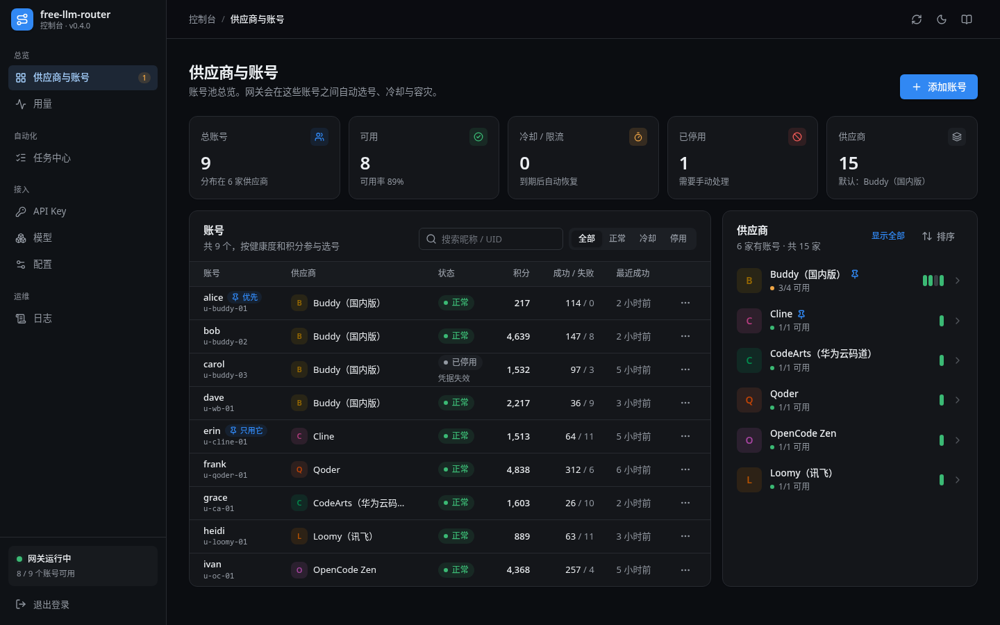

<div align="center">

# free-llm-router

**把多家大模型供应商的账号池，汇成一个 OpenAI 兼容 API。**

自动选号 · 冷却与容灾 · 签到与每日任务自动跑 · 生图 / 视频 / 联网检索 · 自带管理面板


</div>

> [!WARNING]
> **仅限本人授权的账号自用。** 不支持、也不鼓励批量注册、账号出租或转售 API，详见 [使用边界](#使用边界)。



## 目录

- [特性](#特性)
- [两种部署形态](#两种部署形态)
- [快速开始](#快速开始)
  - [方式 A：本地版（不用服务器）](#方式-a本地版不用服务器)
  - [方式 B：VPS / NAS / Docker](#方式-bvps--nas--docker)
  - [方式 C：直接跑 Node](#方式-c直接跑-node)
- [接入客户端](#接入客户端)
- [媒体能力](#媒体能力)
- [支持的供应商](#支持的供应商)
- [管理面板](#管理面板)
- [API 一览](#api-一览)
- [更新与升级](#更新与升级)
- [已知限制](#已知限制)
- [使用边界](#使用边界)

## 特性

### 网关

- **一个入口**：`/v1/models`、`/v1/chat/completions`、`/v1/responses`，支持流式、非流式和工具调用。凡是能填自定义 Base URL 的 OpenAI 客户端都能直接接。
- **出站自动修正**：工具调用配对断裂、`tool_choice`/`tools`/`stop` 形态不对、DeepSeek 思考模式缺 `reasoning_content`、`max_completion_tokens` 不被识别等，都在发出前修好，避免上游 400 让整条会话报废。
- **15 家供应商**：Buddy、WorkBuddy、Cline、MiniMax、CodeArts、LobsterAI、TRAE、Qoder（国内 / 国际）、OpenCode、Raccoon、ZCode、Loomy、Gemini、Meoo。

### 账号池

- **自动调度**：默认先用积分最早到期的账号；失败时按上游错误类型决定换号、罚号还是只冷却某个模型。
- **冷却与熔断**：账号级 / 模型级分开；国内版全部不可用时自动切国际版。
- **聚合模型**：`aggregate/<模型名>` 把多家的同一个模型归到一起，优先走积分最快作废的渠道，失败自动换下一家。
- **多账号登录**：面板里设备码、扫码、短信登录，或粘贴凭据导入（自动识别是哪一家）。

### 自动化

- **每日签到**、**成长任务**（20+ 项，含专家体验、模板、画布、连登兑换、抽奖、猫猫旅行）。
- **国际版每日活跃**：自动跑完网页端 agent 会话（这是国际版拿积分的唯一方式）。
- **后台维护**：每小时续期凭据、刷新余额、清理会话；到期时间未知的凭据也会保活。

### 媒体能力（国际版账号）

- **生图** `/v1/images/generations`、**改图** `/v1/images/edits`（支持传入图片）
- **视频** `/v1/videos/generations`（异步，支持图生视频）
- **联网检索** `/v1/search`、**网页抓取** `/v1/fetch`
- **MCP** `/mcp` —— OpenCode / Claude Code / Cursor / Cline 自动发现工具

### 管理与安全

- **子密钥**：给不同工具各发一把 Key，可限制请求数、token 数、可用模型、来源 IP（CIDR）、过期时间。
- **管理面板**：8 个视图，深浅主题，手机可用；不加载任何外部资源，严格 CSP。
- **凭据加密**：AES-GCM 落盘，密钥不进数据库（除非你选择自动生成）。

## 两种部署形态

| | 本地版 | VPS / 服务器 |
|---|---|---|
| 适合谁 | 自己电脑上用，不想折腾服务器 | 要常驻、要给别人用、要 7×24 跑任务 |
| 怎么装 | 下载压缩包，双击启动 | Docker 或裸 Node + systemd |
| 数据在哪 | 程序同目录 `data/router.db` | 你指定的路径 |
| 开机自启 | ❌ 手动启动 | ✅ systemd / Docker restart 策略 |
| 依赖 | 只要 Node.js 22+ | 只要 Node.js 22+ / Docker |

> 两者是**同一份代码**，只是启动方式不同。数据格式完全一致，可以互相搬。

## 快速开始

### 方式 A：本地版（不用服务器）

**1. 装 Node.js 22+**

| 平台 | 做法 |
|---|---|
| Windows | 去 [nodejs.org/zh-cn](https://nodejs.org/zh-cn) 下载 **LTS** 的 `.msi`，安装时**勾选 Add to PATH**，装完重启电脑 |
| macOS | `brew install node`，或从 nodejs.org 下 `.pkg` |
| Linux | `nvm install 22` 或发行版官方源 |

验证：终端里执行 `node -v`，看到 `v22.x.x` 或更高即可。

**2. 下载并启动**

```bash
# 从 Releases 下载 free-llm-router-local-vX.Y.Z.zip 并解压
cd free-llm-router-local

# Windows：双击 start-windows.bat
# macOS / Linux：
chmod +x start-mac-linux.sh && ./start-mac-linux.sh
```

启动后会自动打开浏览器，屏幕上同时打印**面板地址**与**登录口令**。

```
  ==========================================
    free-llm-router  -  本地版
  ==========================================

  面板地址   http://127.0.0.1:11451/panel/
  登录口令   sk-xxxxxxxxxxxxxxxxxxxxxxxx
  数据目录   /你的路径/data
```

> ⚠️ 那个终端窗口不能关，关掉服务就停了。

**3. 添加账号**

打开面板 → 「供应商与账号」→ 选供应商 → 设备码 / 扫码 / 粘贴凭据。

### 方式 B：VPS / NAS / Docker

```bash
git clone https://github.com/NandaNg314/free-llm-router.git && cd free-llm-router
npm install
npm run build:web && npm run build:node      # 产出 dist/server.mjs（已含面板）

echo "API_KEY=$(openssl rand -hex 24)" > .env
echo "CREDENTIAL_KEY=$(openssl rand -base64 32)" >> .env
cat .env                                      # 记下 API_KEY，登录面板用

mkdir -p data && sudo chown -R 1000:1000 data # 容器内以 uid 1000 运行
docker compose up -d
```

访问 `http://服务器IP:11451/panel/`。

> ⚠️ **务必配置 `CREDENTIAL_KEY` 并备份**：它加密账号凭据。丢了它，所有账号解不开，只能重新登录。
> 不配的话服务会自动在数据库里生成一个 —— 那样一旦 `data/` 丢失同样无法恢复。

**公网部署建议**：用 Caddy / Nginx 反代并只监听 `127.0.0.1`，不要直接暴露端口。

### 方式 C：直接跑 Node

```bash
node --env-file=.env dist/server.mjs
```

需要 Node.js ≥ 22.13（用到内置 `node:sqlite`，零原生依赖、无需编译）。

## 接入客户端

| 客户端 | 配置 |
|---|---|
| **OpenAI SDK / 任何兼容客户端** | Base URL `http://127.0.0.1:11451/v1`，API Key 填子密钥 |
| **Cherry Studio / ChatBox / Open WebUI / LobeChat** | 同上；生图也走这一套（`/v1/images/generations`） |
| **Claude Code** | `ANTHROPIC_BASE_URL=http://127.0.0.1:11451`（走 `/v1/messages`） |
| **Codex / DSH** | Base URL + `/v1/responses` |
| **OpenCode / Cursor / Cline** | MCP：`/mcp`（见下） |

### MCP 接入

```bash
opencode mcp add my-router --global \
  --url http://127.0.0.1:11451/mcp \
  --header 'Authorization=Bearer 你的API_KEY'
```

接入后 AI 会自动发现三个工具：`web_search` / `web_fetch` / `generate_image`。

## 媒体能力

这三项**只有 WorkBuddy 国际版账号**支持（国内账号实测返回 401）。

### 生图

```bash
curl -X POST http://127.0.0.1:11451/v1/images/generations \
  -H "Authorization: Bearer $KEY" -H 'Content-Type: application/json' \
  -d '{"prompt":"一只橘猫坐在窗台上，水彩风格","size":"1024x1024"}'
```

模型是 `hy-image-3.5`，实测约 **10–15 秒**、**0.03 积分/张**。

### 改图（可传本地图片）

`image` 字段接受**公网 URL** 或 **`data:image/...;base64,...`**。面板里选图会自动转成 data URL。

```bash
curl -X POST http://127.0.0.1:11451/v1/images/edits \
  -H "Authorization: Bearer $KEY" -H 'Content-Type: application/json' \
  -d '{"prompt":"把背景换成星空","image":"data:image/png;base64,..."}'
```

> 本网关**不下载、不转存**图片 —— 上游要能直接取到它。

### 视频（异步）

```bash
# 1. 提交（图生视频就加 "image": "data:image/...")
curl -X POST http://127.0.0.1:11451/v1/videos/generations \
  -H "Authorization: Bearer $KEY" -H 'Content-Type: application/json' \
  -d '{"prompt":"一只小猫在草地上奔跑，镜头跟随","seconds":4}'
# → {"id":"1372715883-WandVideo-…","status":"queued"}

# 2. 查询（⚠️ 是 POST，不是 GET）
curl -X POST http://127.0.0.1:11451/v1/videos/tasks \
  -H "Authorization: Bearer $KEY" -H 'Content-Type: application/json' \
  -d '{"task_id":"1372715883-WandVideo-…"}'
```

模型 `kling-video-v3`，实测 **约 73 秒**、**约 29 积分**/4 秒片。

> ⚠️ 含「真实地点 + 人物」的描述容易被上游风控拒绝，会返回 `failed` 与具体原因。

### 联网检索 / 抓网页

```bash
curl -X POST http://127.0.0.1:11451/v1/search -H "Authorization: Bearer $KEY" \
  -H 'Content-Type: application/json' -d '{"query":"今天的上证指数","max_results":5}'

curl -X POST http://127.0.0.1:11451/v1/fetch -H "Authorization: Bearer $KEY" \
  -H 'Content-Type: application/json' -d '{"url":"https://example.com"}'
```

## 支持的供应商

| 供应商 | 对话 | 登录 | 余额 | 签到 | 说明 |
|---|:-:|:-:|:-:|:-:|---|
| Buddy（国内版） | ✅ | 设备码 | ✅ | ✅ | 腾讯 CodeBuddy，任务/成长体系最全 |
| WorkBuddy（国际版） | ✅ | 设备码 | ✅ | — | 每日活跃积分 + **唯一支持生图/视频/检索** |
| Cline | ✅ | 设备码 | — | — | |
| MiniMax | ✅ | 设备码 | ✅ | — | |
| CodeArts | ✅ | 设备码 | ✅ | ✅ | |
| LobsterAI | ✅ | ❌ | ✅ | — | 强制 127.0.0.1 回调，无法远程登录 |
| TRAE | ✅ | ❌ | ✅ | — | 同上 |
| Qoder（国内 / 国际） | ✅ | 设备码 | ✅ | ✅ | |
| OpenCode | ✅ | — | — | — | 匿名通道 |
| Raccoon | ✅ | 扫码 | ✅ | — | |
| ZCode | ✅ | 扫码 | ✅ | ✅ | |
| Loomy | ✅ | 短信 | ✅ | — | |
| Gemini | ✅ | 凭据导入 | ✅ | — | OAuth 形态 |
| Meoo | ✅ | 设备码 | ✅ | — | |

## 管理面板

8 个视图：

| 视图 | 内容 |
|---|---|
| 供应商与账号 | 账号池健康度、每家供应商的账号与能力、单号运维 |
| 用量 | 请求量、token、成功率，按模型和账号拆分 |
| 任务中心 | 签到、成长任务、限时补偿；**自动调度开关** |
| 媒体与检索 | 生图 / 改图 / 视频 / 联网检索 / 抓网页 |
| API Key | 子密钥签发与管理 |
| 模型 | 模型目录、启停、单模型资费探测 |
| 配置 | 接入指南、路由策略、永久积分锁 |
| 日志 | 最近的请求与任务记录 |

## API 一览

| 方法 | 路径 | 说明 |
|---|---|---|
| GET | `/v1/models` | 模型目录 |
| POST | `/v1/chat/completions` | 对话（OpenAI 格式） |
| POST | `/v1/responses` | Responses API |
| POST | `/v1/images/generations` | 文生图 |
| POST | `/v1/images/edits` | 改图 / 图生图 |
| POST | `/v1/videos/generations` | 提交视频任务 |
| POST | `/v1/videos/tasks` | 查询视频任务 |
| POST | `/v1/search` | 联网检索 |
| POST | `/v1/fetch` | 抓网页正文 |
| POST | `/mcp` | MCP（Streamable HTTP） |
| GET | `/version` | 版本号 |
| GET | `/healthz` | 存活探针 |

## 更新与升级

### 本地版

**不会自动更新**，手动做一次：

```bash
# 1. 下载新版并解压到**新目录**（不要覆盖旧目录）
# 2. 在旧目录里执行：
node update-local.mjs ../free-llm-router-local-new
# 3. 重启
```

升级脚本**只替换程序本体**，绝不碰 `.env` 与 `data/`。更新前会自动备份成
`dist/server.mjs.bak-<时间戳>`，出问题改名回去即可回滚。

### VPS / Docker

```bash
git pull
npm run build:web && npm run build:node
docker compose up -d --build
```

`data/` 是挂载卷，升级不影响账号数据。

## 已知限制

- **生图 / 视频 / 检索 / MCP 只支持国际版账号** —— 国内账号在上游侧就是 401，不是我们的限制。
- **两个任务做不了**：`wb_wechat_oa_subscribe_task`（要真实关注公众号满 24 小时）、
  `Sequential_Tasks_1`（小程序口径，判据未验证）。
- **`WorkBuddy_Valorant` 有活动截止日**（2026-11-15），过期后任务消失。
- **视频风控**：含真实地点与人物的描述会被上游拒绝，且不退款。
- **TRAE / LobsterAI 无法面板登录**：它们强制 `127.0.0.1` 回调，只能粘贴凭据。

## 使用边界

本项目**仅用于管理你本人有权操作的账号**。

- ❌ 不支持、不鼓励批量注册小号
- ❌ 不要共享账号、不要转售 API 额度
- ❌ 不要用于绕过平台风控

使用非官方客户端造成的账号风控、限流或封禁，风险自负。

## 开源协议

MIT。第三方组件与参考实现见 [THIRD_PARTY_NOTICES.md](THIRD_PARTY_NOTICES.md)。

> 本项目基于社区多个开源实现（`XuexGao/free-llm-router`、`quancifang44556/free-llm-router` 等）的
> 协议研究成果演进而来，在此一并致谢。
